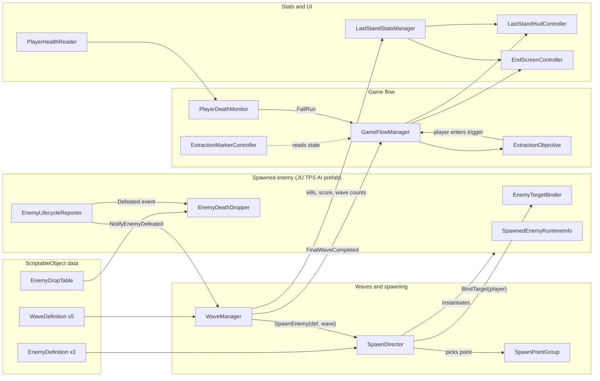
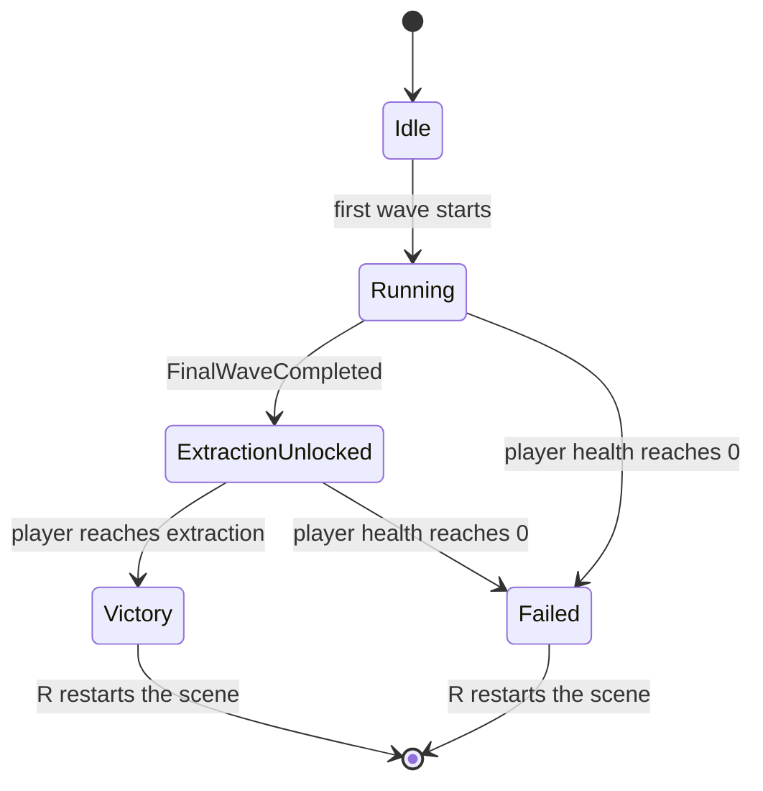
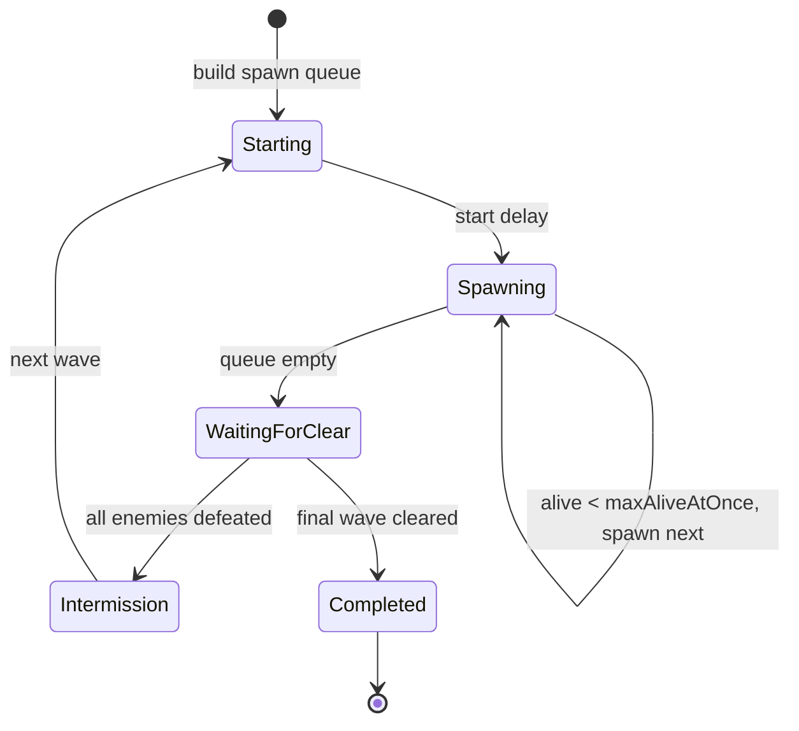

# Architecture

This document explains how the custom Last Stand systems in `Assets/_LastStand/Scripts` fit together and how they sit on top of the third-party foundation.

## Layers

| Layer | Provided by | Responsibilities |
|---|---|---|
| Survival game layer | **This project** (`Assets/_LastStand`) | Run state, wave progression, spawning, defeat tracking, score/kills/time, drops, extraction objective, HUD, end screen, main menu |
| Gameplay foundation | JU TPS (Asset Store) | Third-person controller, camera, weapons, player health, enemy AI behaviours, pause menu |
| Environment | POLYGON Apocalypse by Synty (Asset Store) | City arena, props, vehicles, barricades |
| Engine services | Unity 6 packages | AI Navigation (NavMesh), Input System, uGUI |

## Design principles

1. **No compile-time dependency on JU TPS.** None of the custom scripts import a JU TPS namespace. They talk to JU TPS components at runtime through three small reflection-based adapters:
   - `EnemyTargetBinder` finds AI components on a spawned enemy and fills empty `Target` / `CurrentTarget` style fields with the player.
   - `EnemyLifecycleReporter` polls enemy components for `IsDead`, `IsAlive` or `Health`-style members to detect a defeat.
   - `PlayerHealthReader` reads current/max health from the player for the HUD and death detection.

   The C# code compiles without JU TPS. Only the prefabs and scenes carry the dependency, which kept the third-party source untouched.
2. **Data-driven content.** Enemies, waves and drop tables are ScriptableObjects (`Create > Last Stand > ...`), so balancing was done in the Inspector rather than in code.
3. **Events for cross-system signals.** `WaveManager.FinalWaveCompleted` and `EnemyLifecycleReporter.Defeated` decouple producers from consumers such as `GameFlowManager` and `EnemyDeathDropper`.
4. **Serialized references with a safe fallback.** Managers expose serialized references and fall back to `FindFirstObjectByType` when a reference is left empty, so scenes keep working while they are being rewired.
5. **Built-in debug hooks.** Context-menu commands such as *Debug Start Waves*, *Debug Unlock Extraction* and *Force Report Defeated* let each system be validated in isolation.

## System map



## Run lifecycle

`GameFlowManager` owns the overall run state. It moves to `Running` as soon as the wave system leaves `Idle`, and to `ExtractionUnlocked` when the final wave is cleared.



`WaveManager` runs each wave as a coroutine:



## Key mechanics

### Wave spawning

- `BuildSpawnQueue` expands each `WaveEnemyEntry` (definition × count) into a queue.
- Spawning respects the wave's `maxAliveAtOnce` cap and `spawnIntervalSeconds`.
- If a spawn fails (for example, no valid point on the NavMesh), the queue item is **kept and retried** after a short delay instead of being dropped. This fixed a Wave 4 stall where the wave could never finish (see `dev-log/WAVE4_STALL_FIX.md`).

### Spawn point selection (`SpawnDirector`)

1. Map the enemy role to a spawn role: fist and knife enemies use `Melee` points, ranged enemies use `Ranged` points (`Mixed` points accept both).
2. Keep only points that are eligible for the current wave.
3. Validate each point against the NavMesh (3 m sample radius, 6 m fallback).
4. Skip points closer to the player than their `minDistanceFromPlayer`.
5. If every point is too close, fall back to the distance-relaxed set rather than failing.
6. Instantiate at the sampled NavMesh position, attach `SpawnedEnemyRuntimeInfo` (definition + wave), and bind the player as the AI target.

### Defeat detection (`EnemyLifecycleReporter`)

- Every 0.2 s it scans the enemy's components for dead/alive/health members via reflection.
- `OnDestroy` acts as a fallback report path.
- It reports exactly once: it raises `Defeated` (used by `EnemyDeathDropper`) and calls `WaveManager.NotifyEnemyDefeated`, which forwards the kill to `LastStandStatsManager`. Score comes from the enemy's `EnemyDefinition`.

### Drops

`EnemyDeathDropper` listens for `Defeated` and rolls the `EnemyDropTable`. The default table holds a health pickup and an ammo pickup, each with its own drop chance, gives at most one item per enemy, and scatters the item slightly around the body.

### Extraction

After the final wave, `ExtractionObjective` is unlocked, so its trigger starts accepting the player, and `ExtractionMarkerController` shows a world-space label with the live distance (for example `EXTRACTION: 14m`). Entering the trigger calls `GameFlowManager.CompleteExtraction`, which freezes the stats and shows the *Extraction Complete* screen.

## Content data

### Enemies

| Enemy | Role | Score | First wave |
|---|---|---|---|
| Fist-Based Melee | `FistMelee` | 100 | 1 |
| Knife / Blade Melee | `KnifeMelee` | 150 | 2 |
| Ranged (gun) | `Ranged` | 200 | 3 |

### Waves

| Wave | Name | Fist | Knife | Ranged | Total | Max alive | Spawn interval |
|---|---|---|---|---|---|---|---|
| 1 | First Contact | 3 | - | - | 3 | 2 | 2.5 s |
| 2 | Armed Infected | 3 | 1 | - | 4 | 3 | 2.5 s |
| 3 | Crossfire | 3 | 2 | 1 | 6 | 3 | 2.25 s |
| 4 | Encircled | 4 | 2 | 1 | 7 | 4 | 2.0 s |
| 5 | Last Stand | 4 | 3 | 1 | 8 | 4 | 2.0 s |

A full clear is 28 enemies and 3,500 points. Wave 5 unlocks extraction.

## Folder layout

```text
Assets/_LastStand/
├── Prefabs/Enemies/          # project-owned wrappers around JU TPS AI prefabs
├── Scenes/
│   ├── LS_MainMenu.unity
│   └── LS_Arena_01.unity     # arena built from a copy of a POLYGON Apocalypse demo scene
├── ScriptableObjects/
│   ├── Enemies/              # EnemyDefinition assets
│   ├── Pickups/              # EnemyDropTable assets
│   └── Waves/                # WaveDefinition assets
└── Scripts/
    ├── AI/                   # EnemyDefinition, EnemyTargetBinder, EnemyLifecycleReporter
    ├── GameFlow/             # GameFlowManager, PlayerDeathMonitor, Extraction*
    ├── Pickups/              # EnemyDropTable, EnemyDeathDropper
    ├── Spawning/             # SpawnDirector, SpawnPointGroup, LastStandSpawnPoint
    ├── Stats/                # LastStandStatsManager, SpawnedEnemyRuntimeInfo
    ├── UI/                   # HUD, end screen, main menu, health reader, FPS counter
    └── Waves/                # WaveDefinition, WaveManager
```

Namespaces follow the folders: `LastStand.AI`, `LastStand.GameFlow`, `LastStand.Pickups`, `LastStand.Spawning`, `LastStand.Stats`, `LastStand.UI`, `LastStand.Waves`.
