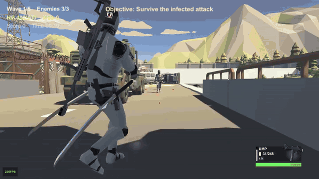
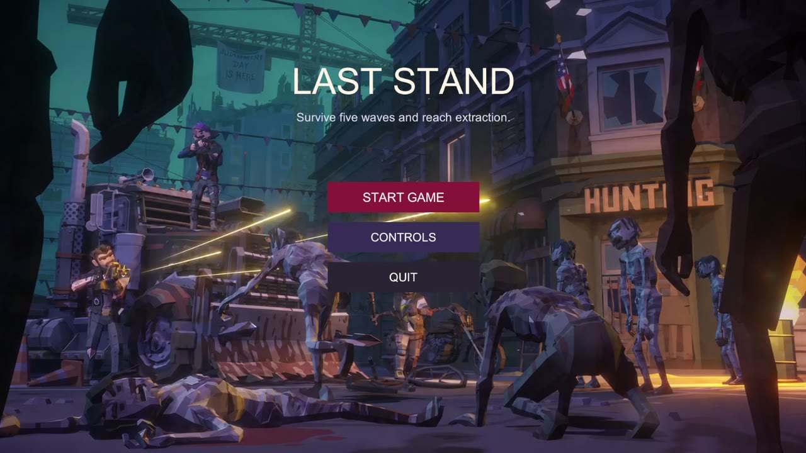
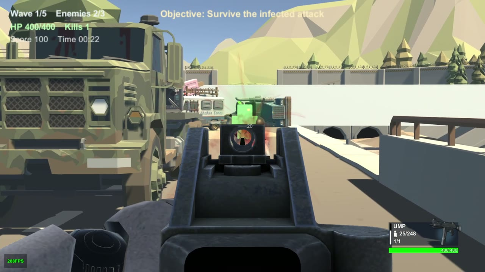
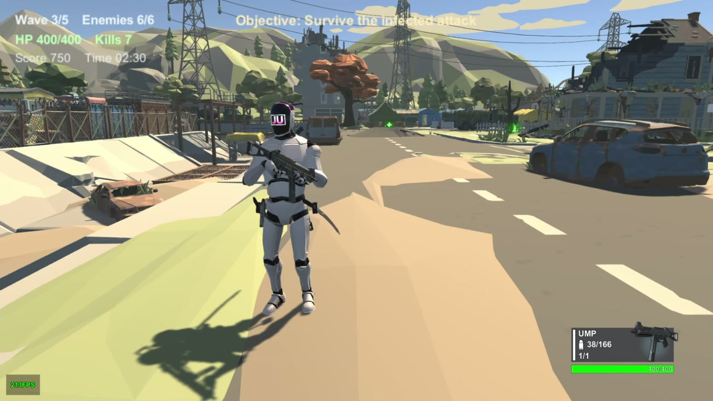
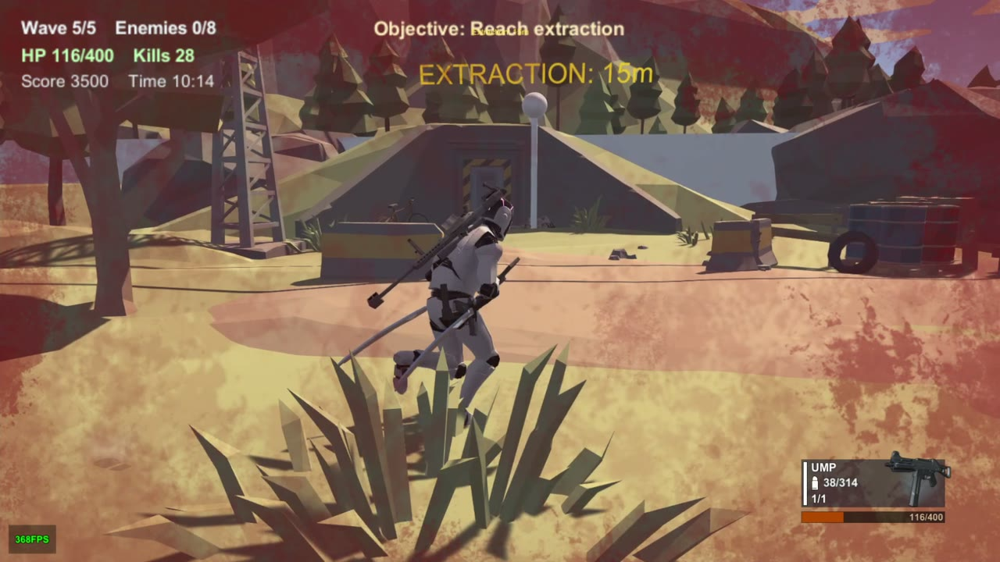
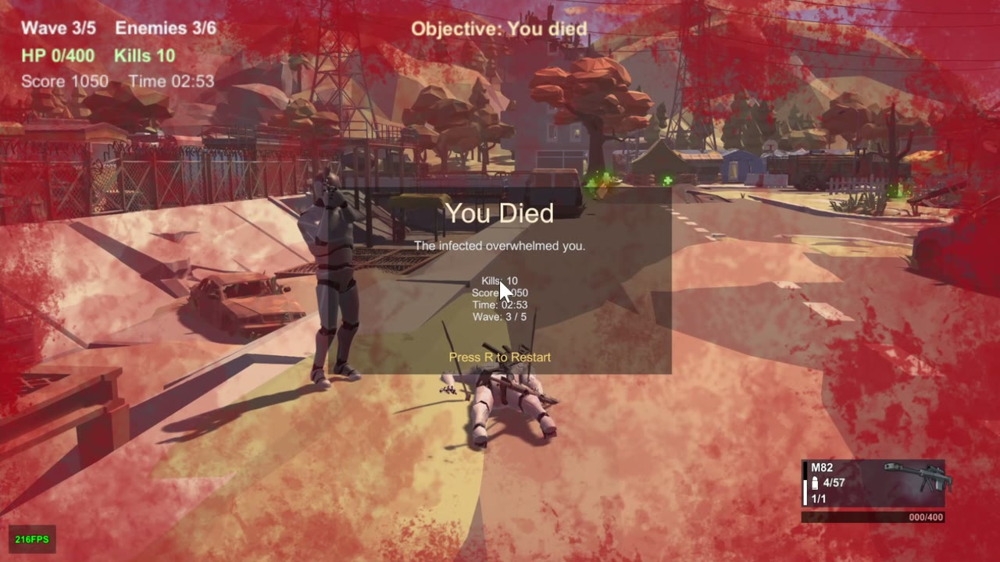
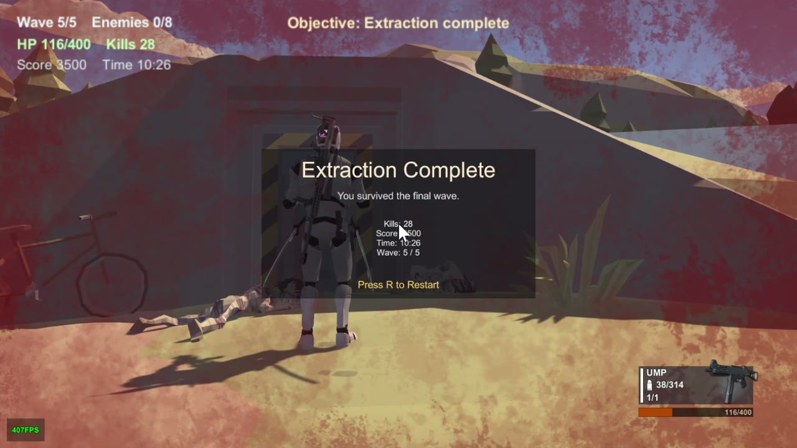
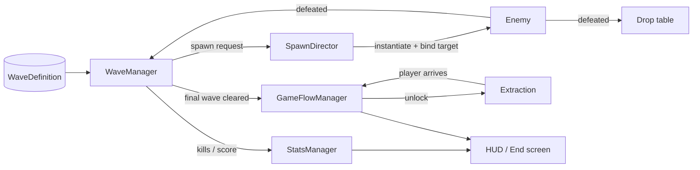

# Last Stand

**A third-person zombie wave-survival shooter built in Unity 6. Survive five escalating waves of infected, then fight your way to the extraction point.**

  

Last Stand is a single-player survival shooter set in a post-apocalyptic city checkpoint. Each wave brings more enemies and new enemy types: fist brawlers first, then blade wielders, then gunmen who shoot from range. Kills can drop health or ammo. Clear the fifth wave and an extraction marker appears. Reach it to win, or go down trying.

It was built as the final project for a university Game and Mobile App Development module (CMP-6056B, 2026). The focus was on **designing the survival game loop and the systems behind it** on top of an existing third-person shooter foundation.

## Screenshots

| | |
|---|---|
|  |  |
| **Main menu.** Start, controls, quit | **Combat.** Aim, shoot, reload; kills update score and drops |
|  |  |
| **HUD.** Wave, enemies remaining, HP, kills, score, time, objective | **Extraction.** Unlocks after wave 5 with a live distance marker |
|  |  |
| **Failure.** Run summary, press R to restart | **Victory.** Final kills, score, time and waves |

## Features

- **Five hand-tuned waves** defined as ScriptableObjects, with per-wave enemy mix, max-alive cap, spawn interval and intermission.
- **Three enemy types**: fist melee, knife/blade melee and ranged gunmen, introduced in waves 1, 2 and 3.
- **Dynamic spawning** that picks spawn points by enemy role, validates them against the NavMesh, and keeps a minimum distance from the player.
- **Full run loop**: main menu, auto-starting waves, extraction objective, victory or failure, end-screen stats and instant restart.
- **HUD** showing wave progress, enemies remaining, health, kills, score, survival time and current objective.
- **Enemy drops**: health and ammo pickups rolled from a configurable drop table.
- **Pause menu** with a return-to-menu option.

## Controls

| Input | Action |
|---|---|
| `W` `A` `S` `D` | Move |
| Mouse | Look / aim |
| Left mouse | Shoot / attack |
| Right mouse | Aim |
| `R` | Reload / restart after the end screen |
| `Shift` | Run |
| `Ctrl` | Roll |
| `C` / `Z` | Crouch / prone |
| `Esc` | Pause menu |

## What I built

The player controller, weapons, enemy AI behaviours and art come from Asset Store packages (see [Credits](#credits)). Everything that turns them into a game lives in [`Assets/_LastStand`](Assets/_LastStand): 27 C# scripts across 7 namespaces, plus the scenes, prefabs and data assets.

| System | Responsibility |
|---|---|
| `GameFlowManager` | Run state machine: Idle, Running, ExtractionUnlocked, Victory / Failed |
| `WaveManager` | Coroutine-driven wave loop, spawn queue, max-alive cap, retry on failed spawn |
| `SpawnDirector` | Role-based spawn point selection with NavMesh validation and distance rules |
| `EnemyTargetBinder` | Binds the player as the AI target at runtime via reflection |
| `EnemyLifecycleReporter` | Detects enemy defeat via reflection and reports it exactly once |
| `LastStandStatsManager` | Kills, score per enemy type, wave counts, survival time |
| `EnemyDeathDropper` / `EnemyDropTable` | Data-driven health/ammo drops |
| `ExtractionObjective` / `ExtractionMarkerController` | Victory trigger and live distance marker |
| `LastStandHudController` / `EndScreenController` / `MainMenuController` | All custom UI |

**Engineering highlights**

- **No compile-time dependency on the third-party controller.** The custom code never imports a JU TPS namespace. It integrates through small reflection-based adapters, so the Asset Store source was never modified.
- **Data-driven balancing.** Enemies, waves and drop tables are ScriptableObjects, so tuning happens in the Inspector without code changes.
- **Robust under real conditions.** Playtesting showed that wave 4 could stall when a spawn failed. The fix keeps the queued enemy and retries, so a wave always completes.
- **Event-based coupling.** `FinalWaveCompleted` and `Defeated` events connect systems without hard references.

More detail, including system and state diagrams: **[Docs/ARCHITECTURE.md](Docs/ARCHITECTURE.md)**.

## Tech stack

- **Engine:** Unity 6 (6000.4.4f1), C#
- **Unity packages:** AI Navigation (NavMesh), Input System, uGUI
- **Third-party assets:** JU TPS (third-person controller and AI), POLYGON Apocalypse by Synty (environment)

## Running the project

> **The paid Asset Store packages are not included in this repository**, because their licences don't allow redistributing the source. Cloning the repo gives you all the custom code, scenes, prefabs and data, but the scenes need those packages to run.

1. Install **Unity 6000.4.4f1**.
2. Import these packages from the Unity Asset Store, using your own licence:
   - JU TPS (Julhiecio TPS Controller), plus JUTPS Addons if your import needs it
   - POLYGON Apocalypse Pack (Synty Studios)
3. Open the project and load `Assets/_LastStand/Scenes/LS_MainMenu.unity`.
4. Press Play. The build order is `LS_MainMenu` then `LS_Arena_01`.

## Known limitations

- The HUD is clear and functional but visually simple.
- Enemies can occasionally hit NavMesh edge cases around dense city props.
- A minimap and a revive-current-wave mechanic were investigated but postponed. The investigation notes are in [`Docs/dev-log`](Docs/dev-log).

## Development process

- The commit history (May 6 to 10, 2026) shows the game built up system by system in small, scoped [Conventional Commits](https://www.conventionalcommits.org/).
- Each system has a plan, a test record and the follow-up fixes in [`Docs/dev-log`](Docs/dev-log). The running logs are [`DEVELOPMENT_LOG.md`](Docs/DEVELOPMENT_LOG.md) and [`TEST_LOG.md`](Docs/TEST_LOG.md).
- **AI-assisted development:** I used OpenAI Codex for planning, scaffolding and drafting code. I integrated, reviewed and playtested all of it in Unity. Every AI-assisted task is recorded in [`Docs/AI_USAGE_LOG.md`](Docs/AI_USAGE_LOG.md).

## Credits

| Asset | Author | Used for |
|---|---|---|
| JU TPS | Julhiecio | Player controller, camera, weapons, enemy AI behaviours, pause menu, pickups |
| POLYGON Apocalypse Pack | Synty Studios | Arena environment, buildings, props, vehicles, barricades |
| AI Navigation | Unity Technologies | NavMesh baking and navigation |

Full details: [Docs/ASSET_ATTRIBUTION.md](Docs/ASSET_ATTRIBUTION.md).

## License

The original code and documentation in this repository are released under the [MIT License](LICENSE). Third-party assets are **not** covered by this licence and remain under their respective Asset Store licences.
